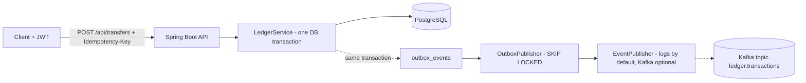

# LedgerFlow


A double-entry ledger service in Java 21 and Spring Boot 3. It moves money between accounts with the guarantees a payments backend needs: no overdrafts under concurrency, safe retries through idempotency keys, and events that are never lost or sent for a transaction that did not commit.



## What it demonstrates

| Concern | How it is handled |
|---|---|
| Money never created or destroyed | Every transaction writes two signed entries that sum to zero (`ledger_entries.delta_minor`); a test asserts this for every transaction in the database |
| No overdraft under concurrency | `SELECT ... FOR UPDATE` on both accounts, always in id order, plus a `CHECK (balance_minor >= 0)` safety net in the schema |
| No deadlocks | Consistent lock ordering; a test fires opposing A to B and B to A transfers at the same time |
| Safe retries | `Idempotency-Key` header. The key is claimed with `INSERT ... ON CONFLICT DO NOTHING` inside the transfer transaction, so two concurrent requests with one key post exactly one transaction and the second gets the stored response (`200`, `Idempotent-Replayed: true`) |
| Key misuse | Same key with a different body returns `422 IDEMPOTENCY_KEY_REUSED` |
| Reliable events | Transactional outbox: the event row commits or rolls back with the ledger rows. A scheduled publisher drains it with `FOR UPDATE SKIP LOCKED` (at-least-once delivery) |
| AuthN/Z | Stateless JWT (HS256) resource server. Users only see and spend from their own accounts; other users' accounts return 404 so ids cannot be probed |
| Schema management | Liquibase migrations (`src/main/resources/db/changelog`) |
| Observability | Actuator health probes, Prometheus metrics (`ledger_transfers_total`, `ledger_transfers_replayed_total`, `ledger_outbox_published_total`), OpenAPI at `/swagger-ui.html` |
| Errors | RFC 7807 problem responses with a stable `code` field |

## Web app

A React + TypeScript UI (`frontend/`) is bundled into the Spring Boot jar and served at `http://localhost:8080/`. Sign in with any name (dev token endpoint), open accounts, send transfers with a visible Idempotency-Key (resend the same key to see a replay; change the amount to see `IDEMPOTENCY_KEY_REUSED`), page through ledger entries, and run the **Concurrency lab**, which fires parallel requests from the browser and checks the guarantees (exactly 10 of 20 transfers succeed, 10 parallel retries create one transaction).

```bash
cd frontend && npm install && npm run build   # writes into src/main/resources/static; the Docker build does this for you
npm run dev                                   # hot-reload UI on :5173, proxies /api to :8080
```

## Run it

New here? Follow `docs/WALKTHROUGH.md`: launch, test, a guided read of the code, an API reference and experiments that break the design on purpose. `scripts/demo.sh` checks every guarantee against a running instance and `scripts/audit.sql` reconciles the database.

Needs Java 21, Maven and a PostgreSQL 16 database. With Docker:

```bash
docker compose up --build        # Postgres + app on http://localhost:8080
```

Without Docker, create a database and run the app (defaults: db `ledgerflow`, user and password `ledger`):

```bash
LEDGER_DEV_TOKEN_ENDPOINT=true mvn spring-boot:run
```

Try it (the token endpoint only exists when `LEDGER_DEV_TOKEN_ENDPOINT=true`; keep it off anywhere real):

```bash
TOKEN=$(curl -s -X POST localhost:8080/api/dev/token -H 'Content-Type: application/json' -d '{"subject":"alice"}' | jq -r .token)

# open an account funded with 100.00 USD (amounts are integer minor units)
curl -s -X POST localhost:8080/api/accounts -H "Authorization: Bearer $TOKEN" -H 'Content-Type: application/json' \
  -d '{"currency":"USD","initialDepositMinor":10000}'

# transfer; repeat the exact call and you get the same transaction back with Idempotent-Replayed: true
curl -i -X POST localhost:8080/api/transfers -H "Authorization: Bearer $TOKEN" \
  -H 'Idempotency-Key: demo-key-0001' -H 'Content-Type: application/json' \
  -d '{"fromAccountId":"<id>","toAccountId":"<id>","amountMinor":2500,"currency":"USD"}'
```

## Kafka mode

The outbox publisher logs events by default. To deliver them to Kafka instead (single-node KRaft broker in Compose):

```bash
docker compose -f docker-compose.yml -f docker-compose.kafka.yml up --build
docker compose -f docker-compose.yml -f docker-compose.kafka.yml exec kafka \
  /opt/kafka/bin/kafka-console-consumer.sh --bootstrap-server kafka:9092 --topic ledger.transactions --from-beginning
```

Delivery is at-least-once; consumers de-duplicate on the `event-id` header.

## Tests

```bash
# needs PostgreSQL; defaults to localhost:5432/ledgerflow_test as postgres/postgres
TEST_DB_URL=jdbc:postgresql://localhost:5432/ledgerflow_test mvn test
```

19 tests run against a real PostgreSQL through the HTTP API, including: 20 parallel transfers of 10 from an account holding 100 (exactly 10 succeed, 10 are rejected, final balance 0), 10 parallel requests with the same idempotency key (one transaction), opposing concurrent transfers (no deadlock), balanced entries, outbox publishing, authorization, validation and pagination. Two more tests cover the outbox itself: a failed publish rolls back and the same events are retried, and the Kafka publisher delivers to an embedded broker with the transaction id as key and `event-id` / `event-type` headers.

I checked that the concurrency tests are meaningful: removing `FOR UPDATE` from the account lock makes them fail.

## Design decisions and trade-offs

- **Balances are stored on the account row and updated under lock**, instead of summed from entries on every read. Reads are cheap; the entries table remains the audit trail and the source for reconciliation.
- **Failed requests do not consume an idempotency key.** The key row is written in the same transaction as the transfer, so a rejected request (for example insufficient funds) rolls everything back and the client can retry the same key after fixing the cause.
- **Deposits come from a per-currency treasury account that may go negative.** Every deposit locks that one row, so deposit throughput in one currency is serialised. The fix at scale is sharded treasury accounts or batching.
- **Plain JDBC (`JdbcClient`) instead of an ORM** so the locking SQL is explicit and reviewable.
- **JWT uses a shared HS256 secret** for simplicity. Production would use an external identity provider with asymmetric keys; override the secret with `LEDGER_JWT_SECRET`.

## Verification status

- 19 tests pass against PostgreSQL 16 and an embedded Kafka broker; `scripts/demo.sh` passes 23 of 23 and `scripts/audit.sql` is clean.
- `Dockerfile` and `docker-compose.yml` were run end to end on Windows with Docker Desktop (demo and audit included).

## Not done yet

- The web UI was driven end to end in headless Chromium against the packaged jar (login, transfer, replay, key reuse, history, both lab experiments), but the Docker image build that bundles it, `docker-compose.kafka.yml` and the GitHub Actions workflow have not been run yet. The Kafka publisher itself is tested against an embedded broker.
- Load-test numbers. Run a load test on your own hardware before quoting throughput or latency figures anywhere.
